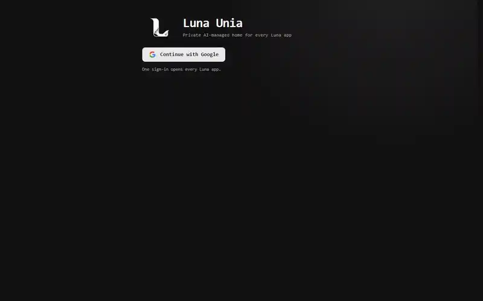
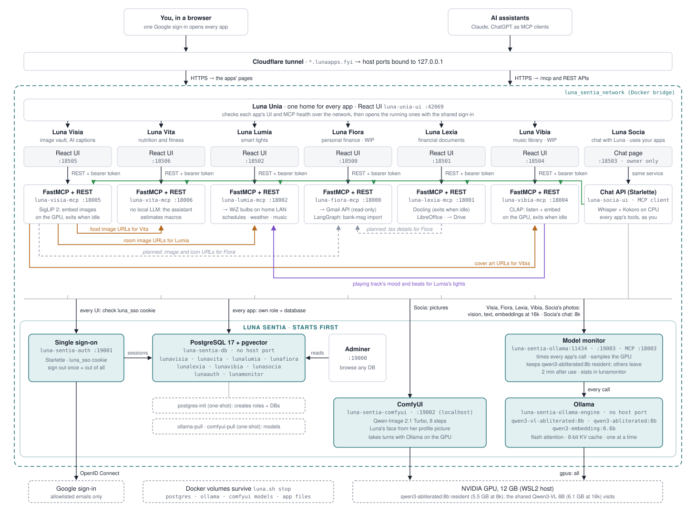

# Luna Socia


<p align="center">
  
</p>

<p align="center">
  <a href="docs/assets/luna-socia-showcase.mp4"></a>
</p>

<p align="center"><em>A made-up user and girlfriend: she remembers what matters by herself, sees the photos you send and knows whose faces are in them, carries what she remembers into a new chat, and shows it in her memory, where you can edit it. Select it for the sharper video.</em></p>

## Text, talk and share photos with your AI girlfriends

> Luna Socia is a local-first, private chat with the AI girlfriends you create: text, voice
> messages, photos, and pictures of her. Everything runs on your own machine, for the owner only.

You create each girlfriend: her name, her face, how she texts, her voice, and what she
remembers about you. She answers by text and, if you like, aloud; she looks at the photos you
send and knows whose faces are in them; she takes pictures of herself, or steps into yours;
and she can use your other Luna apps for you, from playing a song to dimming the lights.
Socia is one service (`ui`): the page and its API, behind Luna's single sign-on.

> **Requires Luna Sentia, running and healthy:** Socia's chat, vision and image models
> run in [Luna Sentia](https://github.com/pranjallk1995/Luna_Sentia), and its data is in
> Sentia's PostgreSQL. Start Sentia first, as described under [Quickstart](#quickstart).

## Models

| Part | Model | Where it runs | Before changing it |
| --- | --- | --- | --- |
| Chat | `LUNASOCIA_CHAT_MODEL` (default `huihui_ai/qwen3-abliterated:8b`, an uncensored Qwen3 8B, about 5.2 GB with 8k context), resident on the GPU | Sentia's Ollama, through its monitor, on the GPU | Compare it with [`model_evaluations/`](model_evaluations/README.md) and check it fits with Sentia's `model_checks/check_model.py --context 8192` |
| Photos sent to Luna | `LUNASOCIA_VISION_MODEL` (default `huihui_ai/qwen3-vl-abliterated:8b-instruct`, an uncensored Qwen3-VL 8B, about 6.1 GB with 16k context, the model every Luna app shares) sees them and answers as her, then describes each photo for her later replies (`LUNASOCIA_VISION_CONTEXT_TOKENS`, default 16384, the context the other apps ask for, so Ollama does not reload it). It takes the chat model's place on the GPU for that reply | Sentia's Ollama, on the GPU | Socia's cat game (`model_evaluations/`), then a few photos by hand |
| Faces in photos | InsightFace `buffalo_l` (SCRFD finds faces, ArcFace makes a face print of each), compared with her profile picture and other pictures, and with your photos in "Photos of you" (similar enough at `FACE_MATCH` 0.55). Paired with the vision model: it tells it whose faces are in each picture | Here, on the GPU (about 0.4 GB, 50 ms a photo): they load with the vision model for a photo and leave with it. Downloaded once to the data volume | `model_evaluations/self_recognition.py` |
| Pictures of Luna | Qwen-Image 2.1 Turbo, 8 steps; 3 of her pictures (her profile picture and up to 6 others) are the face references, drawn at random: those used lately less often, and a little more often those in pictures you liked (❤️ 😘 🔥 👍), so her poses vary | Sentia's image service (diffusers), on the GPU | A few pictures by hand |
| Voice messages | faster-whisper `LUNASOCIA_STT_MODEL` (default `large-v3-turbo`, int8/float16) | Here, on the GPU (`LUNASOCIA_VOICE_DEVICE`, default `cuda`; `cpu` to keep it off the GPU), loaded at start | A few voice messages by hand |
| Her voice | Kokoro 82M, in the voice chosen for her (16 female English and Hindi voices; `LUNASOCIA_TTS_VOICE`, default `af_heart`, for new girlfriends) | Here, on the GPU with Whisper (about 1.5 GB for both, and 0.2 GB for CUDA), loaded at start. Socia measures what each model takes as it loads and reports it to Sentia's monitor | Listen to a few replies |
| Her memory | The chat model reads imported ChatGPT or Claude chats for facts about you, in the background; reading her own chats too is off until it is reliable (`LUNASOCIA_READ_CHATS=1`) | Sentia's Ollama, on the GPU, only while no reply is being written | `model_evaluations/remember.py`, then import a small export and read what she remembers |
| What she remembers by herself | Qwen3-Embedding 0.6B (`LUNASOCIA_EMBED_MODEL`, default `qwen3-embedding:0.6b`, the one Lexia's search uses) embeds your message and her reply, each with the line before it, and two small neurons decide whether either holds a lasting fact. The chat model then writes it in one line (`LUNASOCIA_REMEMBER_AUTO`, default on). The same model finds the lines of her memory your message is about | Sentia's Ollama, resident on the GPU beside her chat model (1 GB, at 4k context: `SENTIA_RESIDENT_MODEL`) | Notebook 03, Part B: the neurons are trained on its embeddings, so train them again |

## The models in Socia itself

Her voice, both ways, and face recognition run inside Socia rather than in Sentia's Ollama.
Whisper and Kokoro load when Socia starts and stay (about 1.5 GB of the GPU, and 0.2 GB for
CUDA); the face models load beside the vision model for a photo and leave with it. Socia
measures what each one takes as it loads and reports it at `GET /api/models`, so Sentia's
model monitor shows them beside Ollama's. Set `LUNASOCIA_VOICE_DEVICE=cpu` to keep them off
the GPU. The face models' weights are for non-commercial use only.

## Who can use it

Only the owner: Socia's page and API refuse everyone else, and Luna Unia shows its card to
the owner only. Its models run on the home's one GPU, and she can act in every Luna app as you.

## Architecture

### Luna ecosystem



<!-- luna-models:start -->
**Which app uses which model.** All of them run on Luna Sentia, which keeps Socia's chat model on the GPU and lets the others visit; see its [Models](https://github.com/pranjallk1995/Luna_Sentia#models) and [Changing a model](https://github.com/pranjallk1995/Luna_Sentia#changing-a-model).

| Model | Served by | Used by | Before changing it |
| --- | --- | --- | --- |
| `huihui_ai/qwen3-vl-abliterated:8b-instruct` (Qwen3-VL 8B, uncensored) | Ollama, at 16k context for every app; in Socia's chat model's place while Luna looks at a photo | Lexia (`DOCUMENT_MODEL`), Visia (`VISION_MODEL`), Vibia (`CAPTION_MODEL`), Fiora (`OLLAMA_MODEL`), Socia's photo replies (`LUNASOCIA_VISION_MODEL`) | `model_checks/check_model.py`, then Lexia's, Visia's and Vibia's `model_evaluations/` and Socia's cat game |
| `huihui_ai/qwen3-abliterated:8b` (Qwen3 8B, uncensored) | Ollama, resident at `SENTIA_RESIDENT_CONTEXT` | Socia's chat (`LUNASOCIA_CHAT_MODEL`) | `model_checks/check_model.py --context 8192`, then Socia's `model_evaluations/` |
| `qwen3-embedding:0.6b` (Qwen3-Embedding 0.6B) | Ollama, resident beside Socia's chat model (1 GB, at 4k) | Lexia's semantic search (`EMBEDDING_MODEL`); what Socia remembers by herself, and the lines of her memory a message is about (`LUNASOCIA_EMBED_MODEL`) | Re-embed with Lexia's `reindex_semantic_search`; train Socia's neurons again (her notebook 03, Part B) |
| Qwen-Image 2.1 Turbo (4-bit text encoder, int8 diffusion model) | Sentia's imagegen (diffusers), GPU, one picture at a time | Socia's pictures of Luna | A few pictures by hand |
| SigLIP 2 (`google/siglip2-base-patch16-224`) | Visia itself, GPU only | Visia's meaning search | Pinned in Visia's image; `backfill_metadata` re-embeds |
| CLAP (`laion/clap-htsat-unfused`) | Vibia itself, GPU or CPU | Vibia's listening and search | Pinned in Vibia's image; every track is heard again |
| Docling (layout, tables, OCR) | Lexia itself, GPU or CPU | Lexia's page reading | Pinned in Lexia's image |
| Whisper `large-v3-turbo`, Kokoro 82M | Socia itself, GPU (about 1.5 GB, and 0.2 GB for CUDA, loaded at start) or CPU | Socia's voice messages and Luna's voice (`LUNASOCIA_STT_MODEL`, `LUNASOCIA_TTS_VOICE`, `LUNASOCIA_VOICE_DEVICE`) | Listen to a few replies; downloaded on first use |
| InsightFace `buffalo_l` (SCRFD, ArcFace) | Socia itself, GPU (about 0.4 GB, loaded with the vision model for a photo) or CPU | Whose faces are in a photo, Luna's or the owner's, told to her vision model | Socia's `model_evaluations/self_recognition.py`; non-commercial licence |
<!-- luna-models:end -->

Every Luna app but Luna Socia is a React UI plus a FastMCP service on Luna Sentia's
`luna_sentia_network`; Socia, the owner's chat with Luna, is one service with no MCP
server of its own. Each app's data lives in Sentia's PostgreSQL, people sign in through Sentia's
`auth`, and model calls go through Sentia's model monitor, which times each one, samples
the GPU and keeps Socia's chat model resident, to its Ollama. Socia's pictures come from
Sentia's image service (Qwen-Image 2.1 with diffusers), which takes turns with Ollama on the GPU. Visia's SigLIP 2, Vibia's CLAP
and Lexia's Docling run inside those apps instead, each in a process that exits when idle.
Orange lines are Visia image URLs that other apps use: food images for Vita, room images
for Lumia, and cover art for Vibia. Grey dashed lines are planned: links into Fiora (tax
details from Lexia, transaction image and icon URLs from Visia). Luna Unia is the one home
for the other apps, on port 42069: it checks which Luna stacks are running and opens each
one with the shared sign-in. The purple line is the mood and beats of the track Vibia
plays, which Lumia's lights follow. The green line is Socia using every app's MCP tools,
and Sentia's, as the owner: it signs in to them with OAuth like any MCP client, so Luna can
play music, dim the lights or find a photo from the chat.

| Component | Technology | Purpose |
| --- | --- | --- |
| Page and API (`luna-socia-ui`, `:18503`) | Starlette, plain HTML, CSS and JavaScript | The chat, her settings, "You", and the Luna apps; for the owner only |
| Chat and photos | Sentia's Ollama, through its model monitor | Her replies (`LUNASOCIA_CHAT_MODEL`, resident) and what she sees (`LUNASOCIA_VISION_MODEL`) |
| Pictures | Sentia's image service, Qwen-Image 2.1 Turbo with diffusers | Pictures of her, her face from her profile picture |
| Voice and faces | faster-whisper, Kokoro, InsightFace on ONNX Runtime, in Socia | Voice messages, her voice, whose faces are in a photo |
| Her phone | MCP client of every Luna app and of Sentia | Using your Luna apps for you |
| Storage | Sentia's PostgreSQL (`lunasocia`) and the `luna_socia_data` volume | Girlfriends, chats, memory; pictures, photos and models |

### How a turn works

1. What you send is stored in the `lunasocia` database, in its chat: your first message in a
   new chat starts it and names it.
2. Her reply streams from the chat model, with her persona (`ui/app/persona.py`), what she
   remembers about you (its core lines, and the details your message is about: `ui/app/recall.py`),
   and the last 20 messages of this chat. Her own
   looks, described once from her profile picture, are part of it.
   - **With a photo**, or a question about one from the last 4 messages ("which one is
     better?", "what did I circle?"), the vision model answers instead. It sees the chat's last
     3 photos and pictures, and the last 16 messages; not her profile picture, which it took
     for one of yours. Under each picture, face recognition says whose faces are in it: hers, yours
     (from your picture and "Photos of you", at the top right), or someone else's. The vision model goes
     by that rather than by how a face looks: on its own it took 23 of 24 women drawn to look
     like her for herself, and with it none. It then describes your photo once, and her later replies, from the chat model,
     read that description in brackets. Right after, Socia swaps the chat model back onto the
     GPU in the background, so your next message does not wait for it.
3. When a picture fits (you ask for a selfie, a picture of the two of you, or for her to step into your
   photo from this chat), she calls her `create_image` tool. Socia sends Sentia's image service the
   prompt (`ui/app/images.py`) with 3 of her pictures as references and, if asked, one of your pictures
   ("selfie together", "add me", "us": drawn like hers, from your picture and "Photos of you") or your
   last photo. Her voice models leave the GPU for it. The service unloads every Ollama model, reads
   the prompt in one process and draws in another, each giving the GPU back when it exits; then the
   monitor loads her chat model back, and her voice returns. About 1.5–4 minutes.

4. When you ask for something one of your Luna apps does, she uses it first: see below.

Measured on an RTX 5070 (12 GB): a reply starts in about 0.3 s, and is written in about 1 s,
once the chat model is loaded; a reply to a photo takes about 15–20 s, most of it loading
the vision model in the chat model's place, and the chat model is back about 4 s later; a
picture takes about 40 s; her voice about 0.2 s per reply; a 30-second voice message about
3 s to transcribe. At rest, her chat model and voice use about 8 GB of the GPU, and about
10.5 GB while she looks at a photo.

## Girlfriends

Create one from the card on the landing page, and change her later with "Edit her":

- **Who she is:** her name, and anything you write about her (age, work, what she loves,
  how you met), which goes into her persona.
- **Her picture:** crop her avatar and add up to 6 more pictures of her, in different poses,
  from her chat's settings; with her profile picture, they show her face. Each picture of her takes 3 of them at random,
  her profile picture like any other, so no one picture sets her face and look: each use raises
  a picture's score, which wears off with time, and the higher it is the less likely it is drawn;
  ones in pictures you react to with ❤️ 😘 🔥 or 👍 come back a little sooner.
- **How she texts:** one of five styles (playful, sweet, sassy, shy, calm), reply length,
  how many emoji, and her language (yours, English, Hinglish, or Hindi in Devanagari).
- **Her voice:** one of Kokoro's English and Hindi voices, each with a sample to play.
  Messages in Devanagari are spoken with the Hindi phonemizer.

Luna, from before there could be several, becomes the first girlfriend when Socia starts:
her chats move to her, and her files to `/data/companions/<id>`.

### You

Your picture at the top right, on every page, opens what every girlfriend knows about you:

- **Your picture** and **what she calls you** (your sign-in's first name until you choose one).
- **About you:** your age, work, what you love; every girlfriend reads it before she replies.
- **Photos of you:** up to 5, so she knows you in the photos you send, with your picture too. A
  picture of the two of you takes one of them at random, the ones used lately less often; their
  clothes and setting can carry over, so plain, well-lit photos of your face work best.
  Each must show a face; one face a photo, straight on and turned a little, works best.

### Her memory

Upload the export ChatGPT or Claude emails you (the .zip, or the `conversations.json` inside
it) in "Edit her". Socia keeps every conversation in `memory_sources`, then the chat model reads
your own messages in each one (not the assistant's) for lasting facts, about 2 s a conversation,
and merges them into a short list (up to 4,800 characters). Reading
pauses while she answers you; the form shows its progress, and you can edit what she
remembers. Importing the same export again skips the conversations she already has.

Reading her chats in Socia the same way is built but off (`LUNASOCIA_READ_CHATS=1` turns it
on): on real chats it still took what photos showed for facts about you.
`model_evaluations/remember.py` checks what she would remember before it is turned on.

**She also remembers by herself.** After each text reply (not a photo turn), Socia reads your
message and her reply, each with the line before it, through a small embedding model (Ollama's
`qwen3-embedding:0.6b`, the one Lexia's search uses). Two neurons
decide whether your message holds a lasting fact about you, or her reply something new about
herself. Only then does her chat model write the fact, as one short line from those words. The
embedding model compares it with what she already has, so a fact she knows isn't saved twice.
- **Where it goes:** a fact about you goes into what she remembers, and one about herself into her
  bio.
- **What you see:** "Remembered:" under her reply.
- **What's stored:** only that one line. Your chat text never is.
- **What it skips:** the neurons speak only when fairly sure. Something she misses, you can remind
  her of, and her `remember` tool still saves what you ask her to remember.
- **The neurons:** Socia ships with neurons trained on written examples. Train your own in
  [notebook 03](notebooks/03_remember_training.py) (Part B), on your chats too, and copy its
  `neurons.npz` to `/data/remember/neurons.npz`; Socia then uses yours.
- **Turning it off:** `LUNASOCIA_REMEMBER_AUTO=0` leaves it to her tool alone.

**What she reads for a reply.** Her whole memory in every reply made her bring it up in small talk,
so each line is sorted once by her chat model, after a turn (`ui/app/recall.py`, from
[notebook 04](notebooks/04_memory_recall.py)):
- **Core** (who you are: family, pets, home, work, health, dates, how you met): always read.
- **Detail** (a like, a habit, a plan): read only when your message is about it. The embedding
  model compares your message with each detail, and up to 6 that are at least 0.5 alike come in.
  "lol" or "good morning" bring up none.
- **Junk** (not a lasting fact, such as "Their message was..."): never read.
- A line not sorted yet is read as core. All she reads stays within 500 tokens.

**What she forgets.** Each time a detail is read it grows stronger, and it weakens with time
(ACT-R's base-level activation: the log of the sum of each read's age in days to the power
-0.5). Past 60 details, junk goes first, then the weakest. Core lines are never forgotten. What
you see and edit in "Edit her" is still her whole memory.

**Refresh**, beside what she remembers in "Edit her", loads the facts saved in chats since you
opened it. Notebook 03 also has a LoRA fine-tune of her chat model, the other way it tries.

Her persona and memory are prompt-only for now: a separate model per girlfriend would not fit
on the GPU beside the resident chat model. The imported conversations stay in the database as
the training data for her fine-tuned model later.

### In the chat

Send text, a voice message (the microphone), or up to 3 photos at once: choose them with the
photo button, or paste one with Ctrl+V. A photo shows straight away with how much of it has
uploaded. On a desktop, the smiley beside it opens an emoji picker. React to a message with an
emoji, or double-tap hers for a heart; she reacts to yours too. Each of her replies can be
read aloud, and any picture downloaded. The pencil beside your message changes its words, marked
"edited"; she reads the new words from her next reply on. The × beside a fact under
"Remembered:" takes it out of her memory or bio.

When your computer has more than one speaker, choose the one her voice plays on under
"Speaker" in the chat's settings (Chrome and Edge; other browsers use the default). The browser
names its speakers once Socia may use the microphone, so "Find speakers" asks for it first. The
choice is kept in that browser; if that speaker is not connected, she plays on the default.

## Her phone: your Luna apps

Luna can use your other Luna apps for you: play a song on the speakers (Vibia), dim the
lights (Lumia), find a photo (Visia), tell you what you ate (Vita) or spent (Fiora), look
up a document (Lexia), or say how busy the GPU is (Sentia). Choose **Connect Luna apps** on
the home page, or in a chat's settings menu, and allow Luna Socia on Sentia's sign-in page,
once. The home page's button then shows how many apps are running, and the settings menu
lists every app as running, not running or not connected; disconnect from either. Each
reply in which she used an app shows which, under it, such as "🎵 Luna Vibia · play_tracks",
kept with the message (`messages.apps`).

- **How it signs in.** Socia registers itself with Sentia's `auth` as an OAuth client and
  asks for one token that names no particular app, so every Luna MCP server accepts it, as
  the owner, like a connector in Claude. The sign-in uses PKCE. Access tokens last an hour,
  and Socia refreshes them itself; each refresh token works once. They are kept in the
  `apps_connection` table. If Sentia stops accepting them, Socia disconnects until you
  connect again.
- **How she uses them.** Her context is 8k tokens, too small for every app's tools. Before
  she answers, the chat model is asked whether your message needs one of the running apps,
  and if so which of its tools (at most three); those she gets as her own functions, such as
  `visia__search_images`, with a line telling her to call one now. She also always has
  three general ones: `app_tools` lists what one app can do, `app_tool_help` shows a tool's
  arguments, and `use_app` runs it. A tool call she writes out as text instead of making it
  is made for her and never shown. She may take up to five rounds before she replies, and
  the page shows "using Luna Vibia…" meanwhile. Each answer she reads is cut to 2,400
  characters.
- **Where.** Socia calls each server on `luna_sentia_network` (`ui/app/apps.py`): Fiora,
  Lexia, Lumia, Vibia, Visia and Vita at `luna-<app>-mcp:8000/mcp`, and Sentia's at
  `luna-sentia-monitor:8001/mcp`. An app that is not running is left out.
- She acts as you, with everything your connectors can do, including deleting. She uses an
  app only when you ask for something it does.

## Quickstart

On one machine you need no `.env`. Clone Socia beside [Luna Sentia](https://github.com/pranjallk1995/Luna_Sentia),
which runs its database, models, and sign-in, then start both:

```sh
git clone https://github.com/pranjallk1995/Luna_Sentia.git
git clone https://github.com/pranjallk1995/Luna_Socia.git
./Luna_Sentia/luna.sh start socia
```

`start` pulls the release images, starts Sentia and waits until it is healthy, then starts
Socia. Once both are up, it deletes the images their new ones replaced. The first start also
downloads the chat, vision and image models, which takes a while. Open
<http://localhost:18503> and sign in as Sentia's owner with one click, then choose a
girlfriend, or create one. To run your local code instead, use
`./Luna_Sentia/luna.sh start --build socia`. Every option of `luna.sh` is in
[Start everything](https://github.com/pranjallk1995/Luna_Sentia#start-everything).

<p align="center">
  <a href="https://github.com/pranjallk1995/Luna_Sentia/blob/main/assets/luna-sh-demo.mp4"></a>
</p>

<p align="center"><em>Start everything, check one app, stop and start it alone, list every app, then
develop with <code>--watch</code>. Select it for the sharper video.</em></p>

## Releases

Each release is on the [Releases page](https://github.com/pranjallk1995/Luna_Socia/releases), with what changed and how to
upgrade. The `docker-compose.yaml` on `main` names the images of the latest release, so
`git pull`, then `./Luna_Sentia/luna.sh start`, updates to it. When a release needs a newer
Luna Sentia, its notes say so: upgrade Sentia first. The release of every Luna app is
listed in [Luna Sentia's Releases](https://github.com/pranjallk1995/Luna_Sentia#releases).

## Start

Sentia's defaults pull `huihui_ai/qwen3-abliterated:8b`, `huihui_ai/qwen3-vl-abliterated:8b-instruct`
and the image model, and create the `lunasocia` role and database with the password
`lunasocia-dev`, which is Socia's default too. Socia uses the GPU for her voice and face
recognition (`gpus: all`), like Sentia's Ollama.

With a tunnel, copy `.env.example` to `.env`, set `UI_PUBLIC_URL`, and route that address to
`127.0.0.1:18503`, under `SENTIA_AUTH_COOKIE_DOMAIN`, so the sign-in cookie reaches it. Every
setting is described in `.env.example`.

## Data model

The `luna_socia_data` volume holds each girlfriend's profile picture and avatar crop
(`/data/companions/<id>`) and her other pictures (`/data/companions/<id>/references`, added
and removed in her settings), the owner's picture and photos of themselves (`/data/owner`, from
"You" at the top right), the pictures and photos of the chats (`/data/images`), and the
voice and face models, downloaded the first time they are used (`/data/models`), with CUDA's kernels
for this GPU (`/data/models/cuda-cache`): the first start compiles them, in about 30 s.

The database keeps each girlfriend (`companions`: persona, voice, memory), her chats (`chats`,
with their `messages` and `images`), and the conversations imported into her memory
(`memory_sources`), each memory line's kind, embedding and reads (`memory_lines`), the owner's name and details (`owner_profile`), and its sign-in to your Luna apps (`apps_connection`). Every chat is kept, so her long-term memory can draw on all of them. On a
desktop, her chats are listed beside the conversation, and on a wide screen her profile is on
the other side; on a phone, open the list from the menu button at the top left. Start a new
chat with the pencil, and rename or delete a chat from the list. Deleting a chat removes its
messages and pictures; deleting a girlfriend (from "Edit her") removes her chats, pictures
and memory.

## Changing a model

Before changing `LUNASOCIA_CHAT_MODEL`, compare the new model with the current one:
[`model_evaluations/`](model_evaluations/README.md) answers a fixed set of made-up
conversations with both, through Socia's own prompt and `create_image` tool, and
scores her texting style, her language, whether she calls `create_image` when (and
only when) a picture is asked for, and time. The chat model stays resident, so check
that it fits with Luna Sentia's `model_checks/check_model.py <model> --context 8192`;
the full list of checks is in Sentia's
[Changing a model](https://github.com/pranjallk1995/Luna_Sentia#changing-a-model).
Before changing `LUNASOCIA_VISION_MODEL`, play the cat game with both (her photos of three
cats, then "who is this?"), run `model_evaluations/self_recognition.py` on photos of her and
of women drawn to look like her, and check that it fits beside her voice and face models when
the chat model has left the GPU.

## Development workflow

### Notebooks

[`notebooks/`](notebooks/README.md) runs Socia's code one step at a time in VS Code, in a container
beside the running Socia (`.devcontainer/`, with no Jupyter server or port), and shows every step's result: what the vision model is sent and answers, the
chat as each model reads it, the tokens, and the GPU while each step runs. `01_photo_flow`
follows a photo to her reply, with the faces found in it and whose they are; `02_picture_flow` follows a picture from her call to Sentia's image service;
`03_remember_training` teaches her when to remember: your labels, the LoRA fine-tune, and the
classifier, each against the same baseline. `04_memory_recall` compares what she reads of her
memory (all of it, or core lines with what a message brings up) and what she forgets, on made-up data. It has its own kernel, **Luna training (torch)**, and
keeps the models it downloads in the `luna_socia_training` volume.
Open them with **Dev Containers: Reopen in Container**. Their outputs (your chats and her pictures) are never
committed.

### Tests

```bash
docker compose build ui
docker run --rm --network none --entrypoint python -v "$PWD/ui/tests:/workspace/ui/tests:ro" \
  ghcr.io/pranjallk1995/luna-socia-ui:v1.3.0 -m unittest discover -s tests
```
